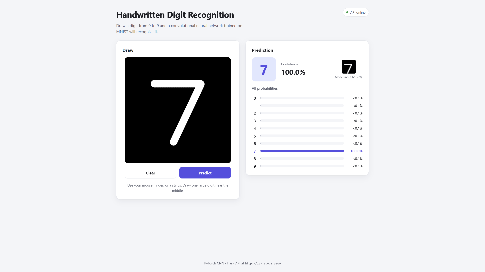
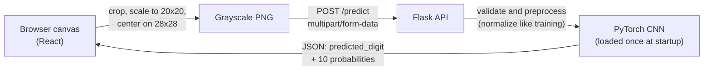

# Handwritten Digit Recognition

Draw a digit in your browser and a convolutional neural network (CNN) recognizes it in real time.

The model is a small CNN trained with PyTorch on MNIST that reaches **99.12% accuracy on the official MNIST test set**. A Flask REST API serves its predictions to a React + Vite drawing interface.

> **Status: in active development.** Everything in [Verified results](#verified-results) has been run and tested locally. Docker and public deployment are planned but **not implemented yet** (see [Future improvements](#future-improvements)).

## Screenshots



*A drawn 7, predicted as 7. The panel shows the confidence, the probability for every digit, and the 28x28 image actually sent to the model. Screenshot from the local end-to-end test.*

## Features

- **Drawing canvas** for mouse, touch, and stylus, with smooth rounded strokes.
- **MNIST-style preprocessing in the browser**: the drawing is cropped, scaled to fit 20x20 without stretching, centered by center of mass on a black 28x28 image, and sent as an 8-bit grayscale PNG.
- **Prediction panel** with the predicted digit, its confidence, and probabilities for all 10 digits.
- **REST API** with input validation (file type, real image format, 28x28 size, 1 MB limit) and JSON error messages.
- **Reproducible training**: fixed random seed, a separate validation split for choosing the best epoch, and one final evaluation on the untouched test set.

## Tech stack

| Layer | Technology |
| --- | --- |
| Model | Python, PyTorch, torchvision |
| Backend | Flask, flask-cors, Pillow |
| Frontend | React 19, Vite 8 (no UI libraries) |
| Testing | pytest with Flask's test client |
| Planned | Docker (not implemented yet) |

## Architecture



Training and inference share one preprocessing module (`backend/model/preprocessing.py`), so images are normalized the same way in both.

### CNN

| Layer | Output shape |
| --- | --- |
| Input (grayscale image) | 1 × 28 × 28 |
| Conv 3×3, 32 filters → ReLU → MaxPool 2×2 | 32 × 14 × 14 |
| Conv 3×3, 64 filters → ReLU → MaxPool 2×2 | 64 × 7 × 7 |
| Flatten → Linear → ReLU → Dropout (0.25) | 128 |
| Linear (one score per digit) | 10 |

## Verified results

### Model

The 60,000 MNIST training images are split, with a fixed seed, into **54,000 for training** and **6,000 for validation**. The validation set picks the best epoch. The official **10,000-image test set** is used only once, at the end, so the test score isn't biased by model selection.

Results from one training run with the default settings (5 epochs, batch size 64, Adam with learning rate 0.001, seed 42):

| Epoch | Training loss | Validation accuracy |
| --- | --- | --- |
| 1 | 0.1664 | 98.30% |
| 2 | 0.0540 | 98.72% |
| 3 | 0.0392 | 98.80% |
| 4 | 0.0295 | 98.95% |
| 5 | 0.0250 | **99.00%** (best, saved) |

**Final test accuracy of the best checkpoint: 99.12%.** The run took about 80 seconds on the GPU listed below, including the dataset download. Reruns with the same seed should give very similar numbers, but they may differ slightly on other hardware or library versions.

### What has been tested

| Area | Check | Result |
| --- | --- | --- |
| Model | Training and final test evaluation | 99.12% test accuracy |
| Model | Command-line predictions on MNIST test images #0 and #123 | Both correct |
| API | `pytest`: 18 tests (health, valid uploads, every 400 case, 405, CORS, model loaded once, one test with the real model) | 18 / 18 passed |
| API | Live server called with `curl` (`/health`, a real MNIST digit, an invalid file) | Expected responses |
| Frontend | `npm run build` | Succeeds |
| End to end | Browser: draw → Predict → result; Clear; phone-width layout; error message when the API is offline | Works as expected |

### Test environment

Windows, Python 3.14.5, PyTorch 2.11.0 with CUDA 12.8, NVIDIA GeForce RTX 5070 Ti Laptop GPU (driver 591.97), Node.js 24.16.0, npm 11.13.0.

## Project structure

```
handwritten-digit-recognition/
├── backend/
│   ├── app.py                # Flask API: GET /health, POST /predict
│   ├── model/
│   │   ├── cnn.py            # CNN architecture
│   │   ├── preprocessing.py  # Normalization shared by training and inference
│   │   ├── train.py          # Train/validation split, training, final test evaluation
│   │   └── predict.py        # Load checkpoint, predict_digit(), command-line demo
│   ├── tests/test_app.py     # API tests
│   ├── pytest.ini
│   └── requirements.txt      # Pinned Python dependencies
├── frontend/
│   ├── src/
│   │   ├── App.jsx           # Page layout and state
│   │   ├── components/       # DrawingCanvas, PredictionResult
│   │   ├── lib/api.js        # API client
│   │   ├── lib/mnistPreprocess.js  # Canvas -> centered 28x28 grayscale PNG
│   │   └── styles.css
│   ├── .env.example          # API URL setting
│   ├── package.json
│   └── package-lock.json     # Exact frontend dependency versions
└── docs/screenshots/
```

These are created locally and **kept out of Git**: `backend/.venv/` (virtual environment), `backend/model/data/` (MNIST, about 65 MB), `backend/model/checkpoints/` (trained weights), `frontend/node_modules/`, and `frontend/dist/`.

## Getting started

### Prerequisites

- Python 3.14 (the tested version; the pinned packages may not be available for much older Python versions)
- Node.js `^20.19.0` or `>=22.12.0` (required by Vite 8), with npm
- Optional: an NVIDIA GPU for faster training. Everything also runs on the CPU.

The commands below use Windows PowerShell. On macOS/Linux, activate the virtual environment with `source .venv/bin/activate` and use `/` in paths.

### 1. Backend setup

```powershell
cd backend
python -m venv .venv
.\.venv\Scripts\Activate.ps1
```

**With an NVIDIA GPU:** install the CUDA build of PyTorch first. This is the command used for the tested environment:

```powershell
python -m pip install torch==2.11.0 torchvision==0.26.0 --index-url https://download.pytorch.org/whl/cu128
```

> CUDA support depends on your GPU generation, NVIDIA driver, and Python version. For example, RTX 50-series GPUs need a CUDA 12.8 or newer build. Check [pytorch.org/get-started/locally](https://pytorch.org/get-started/locally/) for the right command for your machine. You only need an up-to-date NVIDIA driver, not a separate CUDA Toolkit.

**Then, with or without a GPU:**

```powershell
python -m pip install -r requirements.txt
python -c "import torch; print(torch.__version__, torch.cuda.is_available())"
```

Without the CUDA step, pip installs the CPU build of PyTorch and the check prints `False`. That's fine; it's just slower.

### 2. Train your own checkpoint

The trained weights are **not included in the repository**. Create them with:

```powershell
python -m model.train
```

This downloads MNIST (about 12 MB, about 65 MB once extracted) to `backend/model/data/`, trains for 5 epochs, saves the best checkpoint to `backend/model/checkpoints/mnist_cnn.pth` (about 1.7 MB), and prints the final test accuracy. Options: `--epochs`, `--batch-size`, `--lr`, `--seed`.

Quick check from the command line:

```powershell
python -m model.predict --index 0     # an MNIST test image; also prints the true label
```

### 3. Run the API

```powershell
python app.py
```

The API listens on `http://127.0.0.1:5000`. It loads the checkpoint once at startup and stops with a clear error if you haven't trained yet. This is Flask's development server, meant for local use only.

### 4. Run the frontend

In a second terminal:

```powershell
cd frontend
npm ci          # installs the exact versions from package-lock.json
npm run dev
```

Open [http://localhost:5173](http://localhost:5173). The badge in the corner shows whether the page can reach the API.

To point the frontend at a different API address, copy `frontend/.env.example` to `frontend/.env.local`, edit `VITE_API_BASE_URL`, and restart `npm run dev`. No API keys are needed.

### 5. Run the tests

```powershell
cd backend
python -m pytest
```

Most tests mock the model, so they need no GPU or checkpoint. The real-model test is skipped automatically when no checkpoint exists. To check the frontend production build, run `npm run build` in `frontend/`.

## API reference

### `GET /health`

`200 OK` → `{"status": "ok"}`

### `POST /predict`

Request: `multipart/form-data` with a file field named **`image`**, containing a **28x28 PNG or JPEG**. Like MNIST, the digit should be white on a black background. Color images are converted to grayscale.

```powershell
curl.exe -F "image=@digit.png" http://127.0.0.1:5000/predict
```

`200 OK` response:

```text
{
  "predicted_digit": <integer 0-9>,
  "probabilities": [<p0>, <p1>, ..., <p9>]   // probabilities[i] = confidence for digit i; they add up to 1
}
```

Errors return JSON shaped like `{"error": "<message>"}`:

| Status | Cause |
| --- | --- |
| 400 | Missing `image` field, empty filename, unsupported extension, not a real PNG/JPEG, not 28x28, or corrupted data |
| 405 | Wrong HTTP method |
| 413 | Upload larger than 1 MB |

CORS allows the Vite dev server origins `http://localhost:5173` and `http://127.0.0.1:5173` (`FRONTEND_ORIGINS` in `backend/app.py`). The dev server uses `strictPort`, so it won't silently move to another port that the API would reject.

## Troubleshooting

- **`python` opens the Microsoft Store or says "Python was not found" (Windows):** turn off the `python.exe` entry in *Settings → Apps → Advanced app settings → App execution aliases*, or run `.\.venv\Scripts\python.exe` directly.
- **`Activate.ps1` is blocked:** run `Set-ExecutionPolicy -Scope CurrentUser RemoteSigned` once.
- **The frontend says "Can't reach the prediction server":** start the API (`python app.py` in `backend/`) and check `VITE_API_BASE_URL`.
- **`Port 5173 is already in use`:** stop the other process using that port. The API only accepts requests from port 5173.

## Future improvements

None of these are implemented yet.

- **Docker:** Dockerfiles for the backend and frontend, plus a `docker-compose.yml`.
- **Deployment:** a production WSGI server (for example Gunicorn or Waitress) instead of Flask's development server, hosting the frontend build, and making CORS origins configurable for a public URL.
- **Pretrained checkpoint download:** publish `mnist_cnn.pth` as a GitHub Release asset so users can skip training.
- **CI:** GitHub Actions to run the backend tests and frontend build on every push.
- **Model:** data augmentation (small rotations and shifts) to handle messier real-world handwriting.
- **Frontend tests:** unit tests for the preprocessing and automated browser tests.

## License

[MIT](LICENSE) © 2026 Tony Zhang. The MNIST dataset is not included in this repository; `torchvision` downloads it during training.
